<div align="center">

<h1>slot. XMB</h1>

<p><b>A PSP-style XrossMediaBar skin for <a href="https://github.com/BrandonKowalski/slot">slot</a>, the Game Boy-centric frontend for the Anbernic RG SP.</b></p>

<p>slot is made by <a href="https://github.com/BrandonKowalski">Brandon Kowalski</a>. All of the emulation, saves, link play and everything else under the skin is his work.</p>

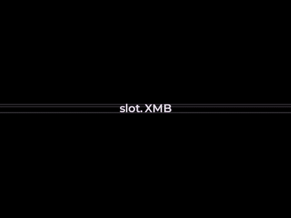

</div>

---

> [!NOTE]
> This is an unofficial fork. It isn't affiliated with Sony or with the upstream slot project. Bugs in the XMB skin belong here, not upstream.

# What is this?

[slot](https://github.com/BrandonKowalski/slot) by Brandon Kowalski is a frontend for the Anbernic RG SP that plays GBA, GBC and GB games. This fork keeps slot's emulation, save handling, link play and settings, and replaces its menus with a PSP-style bar.

Everything here is built behind a `xmb` cargo feature. Without that feature, slot builds and behaves exactly like upstream.

# What does it look like?

<p align="center">
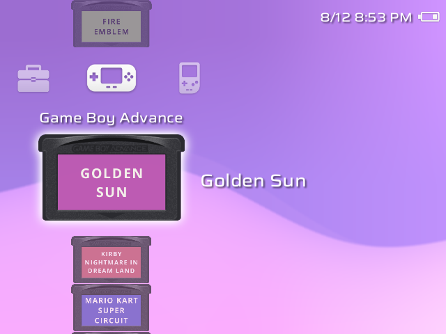
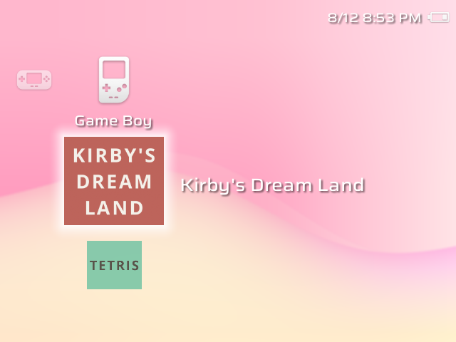
</p>
<p align="center">
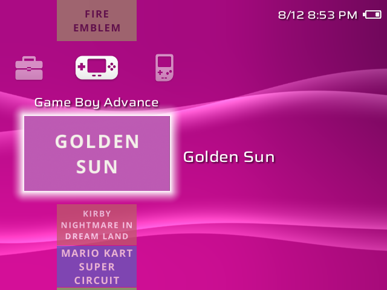
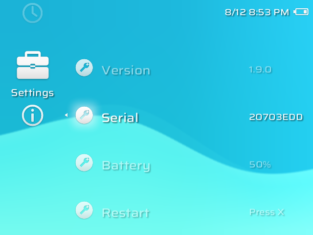
</p>
<p align="center">
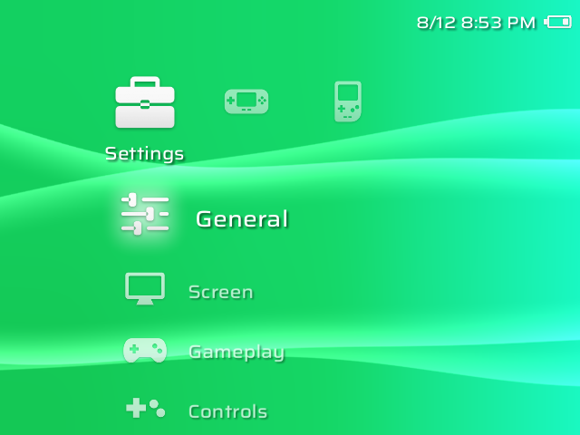
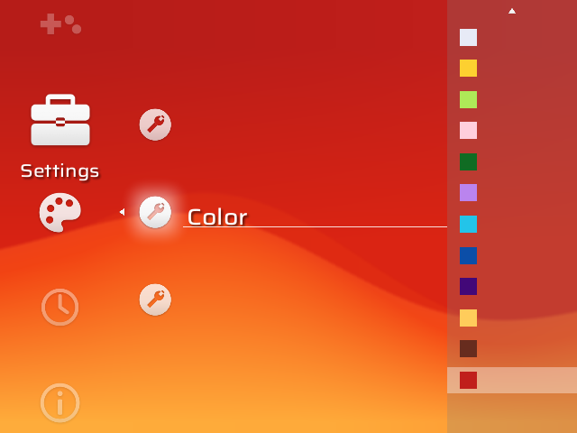
</p>
<p align="center">
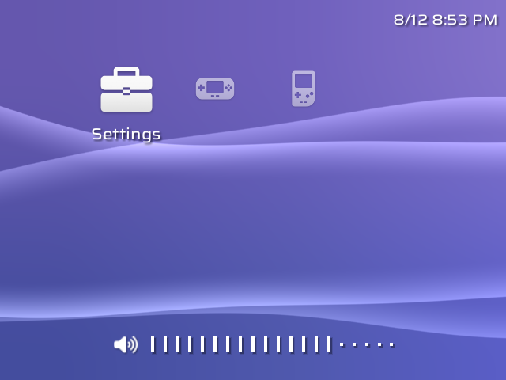
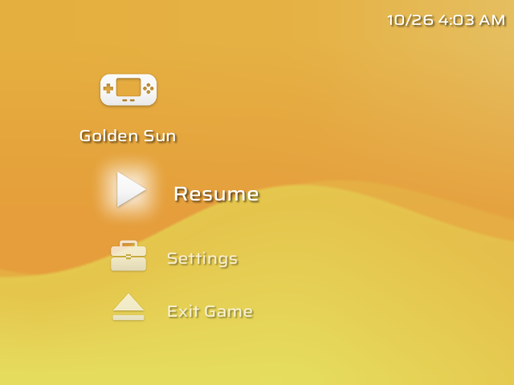
</p>
<p align="center">
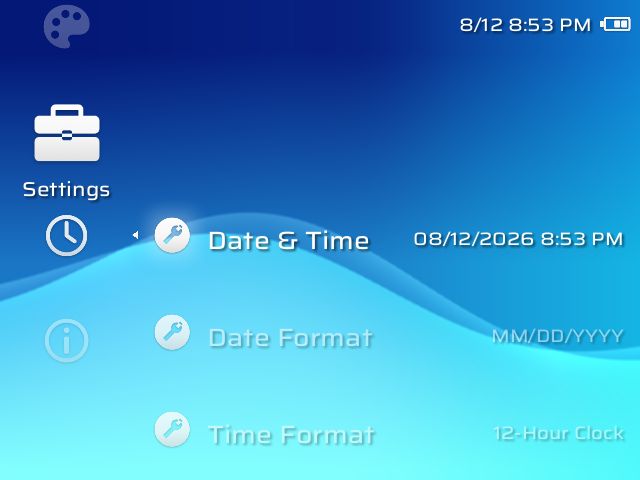
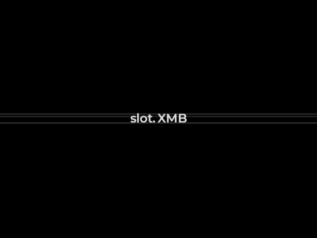
</p>

# What's different

**The bar**

- Categories run across the screen and items run down it, with the PSP's sizes, spacing, highlight glow and the small arrow beside an open item.
- Game names show only on the game under the cursor.
- The clock and battery sit at the top right and hide whenever a side menu is open. A battery percentage can be shown next to the battery icon.

**Waves and colours**

- **Original** and **Classic** wave backgrounds, both drawn on the GPU.
- 34 background colours fitted from screenshots of a real PSP, each with its own edge glow and shading. There's also a By Month option that changes the colour each month.
- A **Wallpaper** background replaces the waves with your own picture.

**Start-up and switch-off**

- On power-up the screen shows a boot picture that reads "slot. XMB".
- The start-up animation takes over from that picture without a jump. The lines brighten, colour spreads out from them, and the waves grow out of them.
- Games and settings load while the animation plays. If loading takes longer, the waves stay up with a pulsing ring at the lower left.
- Switching off plays the animation in reverse.
- Booting straight back into a game you left running skips the animation and goes from the boot picture to the game.

**Settings**

- Theme Settings: Background, Color (or Wallpaper), and Game Icons.
- Date & Time Settings: a PSP-style clock editor, date format, 12- or 24-hour time, and time zone.
- Volume, brightness and screen-temperature gauges in the PSP's style.
- About sits at the bottom of Settings and scrolls.

**Power use**

- When nothing is moving on the home screen, the bar draws at 20 frames per second instead of 60, so the device runs cooler.

# Install

Download the latest release from this fork's [releases page](../../releases/latest). It's the complete slot card layout, with the same cores, scripts and folders, plus the XMB build of `System/slot`.

- **New install:** follow the [slot guide](https://slot-cfw.fyi), using this fork's release zip in place of slot's own.
- **Updating, or switching from slot v1.9.0:** copy `System/slot` from the zip over the one on your SD card. Your games, saves and settings stay as they are.

The boot picture is written to the device the first time the new build runs. It shows from the following boot onwards.

## Your PSP's own background colours (optional)

The colours are fitted from screenshots of a PSP. If you have a PSP or PS Vita with custom firmware, you can give Original waves your console's exact backgrounds. Copy these files from `flash0:/vsh/resource/` on your console to `System/xmb/` on the SD card:

- `13-27.bmp`
- `01-12_03g.bmp`, or `01-12.bmp` on a PSP-1000 or PSP-2000

They aren't included here, and nothing changes if they're missing.

## Sounds (optional)

The bar plays short sound effects if it finds them on the SD card. **They aren't included in this repo**, so you need to supply your own. Each must be a 16-bit PCM WAV, at any sample rate, mono or stereo.

| File | Plays when |
| --- | --- |
| `System/sounds/opening.wav` | the start-up animation runs |
| `System/sounds/cursor.wav` | you move the selection |
| `System/sounds/confirm.wav` | you open or choose something |
| `System/sounds/cancel.wav` | you back out |
| `System/sounds/start.wav` | the device boots straight back into a game |

If a file is missing, that sound is simply silent.

# Build

These are the same steps as upstream, with the `xmb` feature on:

```sh
cargo build --profile device --target aarch64-unknown-linux-gnu \
  -p slot --no-default-features --features device,xmb
```

The XMB screenshots in this README come from a software-rendered test:

```sh
XMB_SHOTS=shots cargo test --release -p slot \
  --no-default-features --features device,xmb --test xmb_shots
```

# Credits

- **[slot](https://github.com/BrandonKowalski/slot) by [Brandon Kowalski](https://github.com/BrandonKowalski).** This fork is built on slot v1.9.0 and wouldn't exist without it. Read the [slot guide](https://slot-cfw.fyi) and the [upstream changelog](https://github.com/BrandonKowalski/slot/blob/main/CHANGELOG.md), and if you enjoy slot, you can [support Brandon on Ko-fi](https://ko-fi.com/kwallbmoc).
- [BaseOS](https://github.com/pvaibhav/BaseOS), the system slot runs on.
- Fonts: [Saira](https://github.com/Omnibus-Type/Saira) and [Montserrat](https://github.com/JulietaUla/Montserrat), both under the SIL Open Font License.
- The look is modelled on Sony's PSP XrossMediaBar. PlayStation, PSP and XrossMediaBar are trademarks of Sony. This fork contains no Sony code, artwork or audio.

# License

GPL-3.0, the same as upstream. See [LICENSE](LICENSE).

slot is the work of Brandon Kowalski. This fork modifies slot v1.9.0 (commit `20703ed`): the changes, made in October 2026, add the `xmb` feature and its art, fonts, animation and settings. The full history of both is in this repository's commits.
